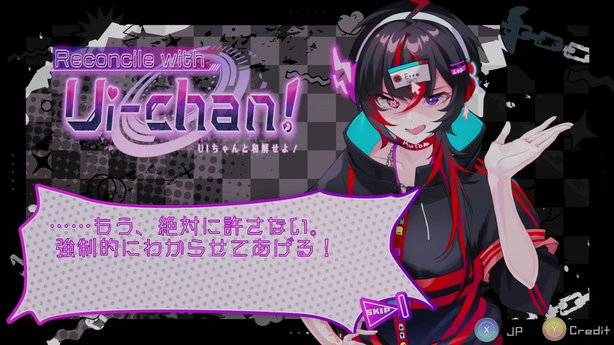
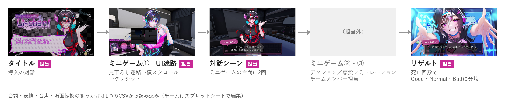
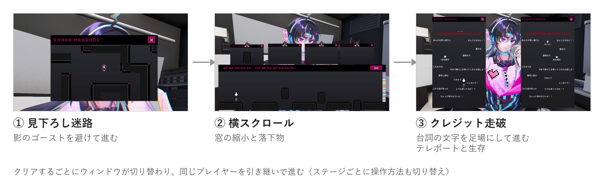
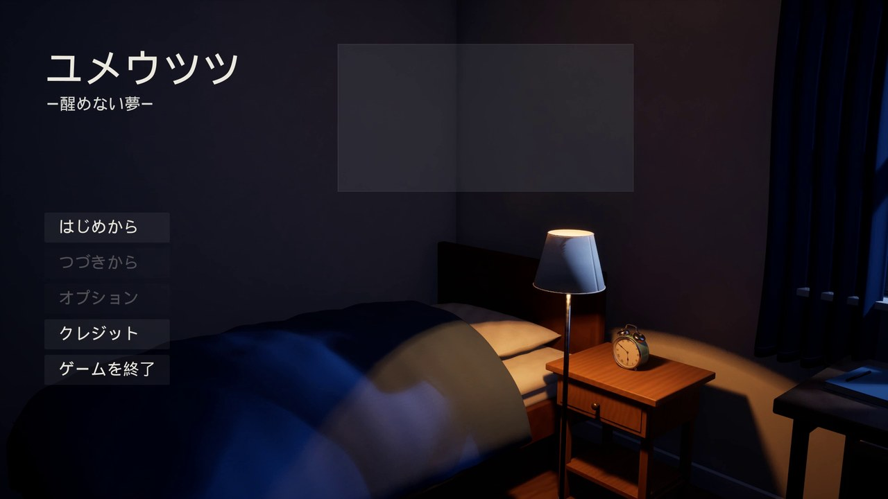

# CHUNG MINSEO — ゲーム制作ポートフォリオ

立命館大学 情報理工学部（2028年3月卒業見込み）。クライアント／ゲームプレイプログラマーを志望しています。

---

## 1. Reconcile with Ui-Chan!（BitSummit Game Jam 2026・9人チーム）

  

- **役割**：プログラマー（タイトル画面、対話シーン、UI迷路ミニゲーム、リザルト画面、画面共通の日英対応）
- **エンジン**：Unity 6 (6000.0.59f2) ／ C# ／ URP
- **制作期間**：100日間（2026年2月14日のキックオフ〜5月22〜24日のBitSummit展示）
- **チーム**：9人（プランナー3、アーティスト2、UIデザイナー1、プログラマー3）
- **受賞**：協賛企業賞（PixAI賞）、審査員個人賞（メタいで賞）
- **コード**：[`Reconcile-with-UIChan/src/`](Reconcile-with-UIChan/src/)（担当部分 C# 85ファイル）
- **ダウンロード**：[itch.io（BitSummit Game Jam 2026）](https://bitsummit-gamejam.itch.io/uityantowakaiseyo)

### ゲームの流れと担当範囲

  

### 担当した内容
- **対話シーン**（[`Dialogue/`](Reconcile-with-UIChan/src/Dialogue/)）：日英の台詞と音声、表情、場面転換のトリガーを1つのCSVにまとめ、スプレッドシートでチームの誰でも編集できるようにしました。台詞は1文字ずつ表示します。UniTask と CancellationToken で対話ループを非同期に進め、再呼び出し時は安全に中断します。
- **UI迷路ミニゲーム**（[`UIMazeV2/`](Reconcile-with-UIChan/src/UIMazeV2/)）：見下ろし迷路（影ゴーストを回避）→ 横スクロール（窓の縮小と落下物）→ クレジット走破（テレポートと生存）の3つのステージを、クリアするごとにウィンドウを切り替えながら、同じプレイヤーを引き継いで進みます。ステージに応じて操作方法を切り替えます。軌跡を記録・再生して追ってくる「自分の影」のゴースト、ディゾルブ・グリッチの演出を制御するスクリプトを実装しました。
- **タイトル画面**（[`Title/`](Reconcile-with-UIChan/src/Title/)）：ライセンス表記ウィンドウ、日英切替ボタン、ボタン操作で台詞が変わる演出とゲーム開始の演出。
- **リザルト画面**：全ミニゲームの合計死亡回数で、グッド・ノーマル・バッドの3種のエンディングに分岐します。
- **日英対応（画面共通）**：言語の切り替えをイベントで各画面に通知し、台詞・フォント・音声をボタン1つで切り替えます。言語ごとに文字サイズを調整し、台詞が足場になるステージは英語版の足場配置を作り直しました。
- **展示期間中の修正**：会場で来場者のプレイを見て、毎晩修正したビルドを翌日に持ち込みました（操作ガイドの矢印、テレポート位置を光らせる演出、死亡が二重に数えられる不具合の修正、スクロール速度とエンディング基準の調整）。

  

---

## 2. ユメウツツ ―醒めない夢―（個人制作・β版）

  

- **エンジン**：Unreal Engine 5.8 ／ C++ ＋ Blueprint
- **制作期間**：2026年4月〜（制作中）
- **コード**：[`YumeUtsutsu/src/`](YumeUtsutsu/src/)（C++ 160ファイル。UE上のプロジェクト名は `Quietus`）
- **概要**：眠りの先は、捕まるたびに形を変える夢の迷路。斧を持つピエロから逃げながら「夢の欠片」を集めて扉にはめ込み、その先の目覚まし時計に触れると目を覚ます一人称ホラー脱出ゲームです。捕まると命を一つ失い、迷路は自動生成で別の構造に作り直されます。難易度は夢・悪夢・猿夢の3段階です。
- **制作について**：企画、ルール設計、演出、プレイ確認まで自分で行っています。

### 主な仕組み
- **迷路の自動生成**（[`Generation/`](YumeUtsutsu/src/Quietus/Generation/)）：シードから部屋と廊下を配置し、部屋中心間の距離でMST（プリム法）を作ったうえで、行き止まりだけにならないようループ接続を追加します。扉の周囲から家具を除くルールや、部屋の大きさ・数の調整は、実際に遊びながら見直しています。
- **敵AI**（[`Enemies/`](YumeUtsutsu/src/Quietus/Enemies/)）：AI Perception（視覚・聴覚）と Behavior Tree。ピエロは音に反応し、走る音、投げたビン、割れた風船の音でおびき寄せられます。
- **ギミック**（[`Interactables/`](YumeUtsutsu/src/Quietus/Interactables/)）：一度だけ使える虹色の扉（別の扉へ瞬時に移動、虹色の間はピエロも通れない）、風船、ビン、隠れられるロッカー。
- **プレイヤー**（[`Player/`](YumeUtsutsu/src/Quietus/Player/)）：電池式の懐中電灯、スタミナ、しゃがみ、調べる・拾う・隠れるの相互作用。
- 画面の文言はすべて `LOCTEXT`（原文日本語）で、後から翻訳を追加できる形にしています。

---

## 使用言語
- **C#**（Unity でのゲーム制作）
- **C++**（Unreal Engine でのゲーム制作、2026年4月〜）
- **Python**（大学の講義：機械学習）
